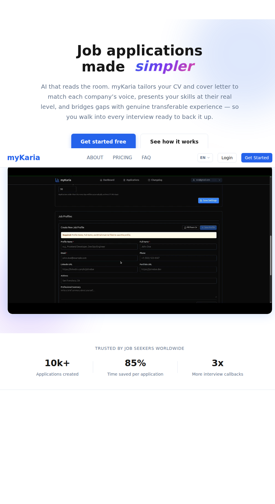

# myKaria

An AI job-application pipeline that writes CVs and cover letters at the
candidate's real level, not at the level of the job ad.

Live product: [mykaria.com](https://mykaria.com)



This repository is a curated public slice of a production SaaS I designed,
built and operate. The full application is private. What is public here is the
part worth reading: the prompt assembly layer, the skill-matching pipeline, the
deterministic post-processing around the model, and the tests that pin all of it
down.

One-page write-up: [case study (PDF)](docs/case-study.pdf) | [case study (Markdown)](docs/case-study.md)

```
npm install
npm test
# 2 suites, 148 tests passing
```

## The problem

Every AI resume tool optimises for callbacks, so they inflate. The candidate
gets the interview and loses it, because the claims in the document cannot be
defended under questioning. Recruiters have seen enough generated CVs to
discount them by default.

myKaria takes the opposite constraint: the output must be defensible. That
turns a writing problem into a ranking and policy problem:

- which of the candidate's skills actually match this role, and how strongly
- at what proficiency the candidate can honestly claim each one
- which skills should be featured, mentioned, framed as growth, or omitted
- which required skills the candidate does not have, and what adjacent real
  experience can carry that gap without inventing anything

## The pipeline

```
job ad (PDF | URL | text)
        |
        v
  extraction            cheerio + pdf-parse -> structured JD
        |               (title, requirements, seniority, language)
        v
  skill match           ONE LLM call, returns matched / unmatched /
        |               irrelevant / complementary terms
        v
  policy pass           deterministic: tier assignment, growth cap,
        |               always-include forcing, irrelevant-skill removal
        v
  prompt assembly       CV prompt + cover letter prompt, sharing the
        |               same match result (no second matching call)
        v
  generation            multi-provider LLM client, token + cost accounting
        |
        v
  rendering             Handlebars templates -> HTML -> PDF (Puppeteer)
        |
        v
  post-generation       section-level editing, translation, application tracking
```

The design rule throughout: **the model makes judgements, the code makes
policy.** Anything that has to be true every time (a beginner skill never
appears as expert, an irrelevant skill never reaches the prompt, a truncated
response never silently empties both skill lists) is enforced in code that can
be tested, not in a sentence in the prompt.

## What is in this repository

```
src/services/prompts/prompt-builder.js      prompt construction, 529 lines
src/services/content/skill-matcher.js       AI skill matching, 304 lines
src/services/content/text-post-processor.js output normalisation, 105 lines
src/services/content/language-detector.js   DE/EN detection, 148 lines
src/utils/jd-title-sanitizer.js             job title cleanup, 101 lines
src/utils/date-format.js                    locale-safe dates, 47 lines
src/constants/index.js                      shared domain constants
src/services/llm/index.js                   stub, see note below
tests/                                      148 tests, all passing
docs/adr/                                   20 architecture decision records
```

The LLM client is stubbed on purpose. In production it wraps OpenAI, Anthropic,
Ollama, OpenRouter and any custom OpenAI-compatible endpoint, with retry,
provider fallback and per-call cost resolution. The unit tests here mock it, so
the deterministic layers run without an API key.

## Engineering decisions

The decision records are the fastest way to see how the product was reasoned
about. Start with these:

- [ADR 0006](docs/adr/0006-skill-matching-pipeline.md) skill matching pipeline:
  why one LLM call instead of three, and what breaks when the response truncates
- [ADR 0010](docs/adr/0010-adaptive-context-handling.md) adaptive context
  handling: keeping long job ads and long profiles inside the model's budget
- [ADR 0013](docs/adr/0013-bullet-selection-before-cv-generation.md) selecting
  bullets before generation instead of after
- [ADR 0007](docs/adr/0007-company-research-for-skill-enrichment.md) and
  [ADR 0009](docs/adr/0009-user-controlled-company-research-with-tier-gating.md)
  company research, and gating it by subscription tier
- [ADR 0005](docs/adr/0005-language-translation-system.md) translation of
  generated documents
- [ADR 0019](docs/adr/0019-live-pricing-portal-mounts.md) live pricing rendered
  from the billing provider

## Stack

- Backend: Node.js, Express, Prisma, PostgreSQL, Stripe, Puppeteer,
  Handlebars, Nodemailer
- Frontend: Next.js 15, React 19, TypeScript, TipTap, Radix, PostHog
- Infra: Docker Compose, Jenkins pipeline, 68 database migrations
- Product surface: 23 document templates, DE and EN, FREE/BASIC/PRO/ENTERPRISE
  tiers, admin console, application tracker, daily AI insight

## What is deliberately not here

Authentication and session handling, billing logic, multi-tenant data
isolation, the database schema, production deployment configuration, the
provider client, and the internal wiki. Publishing those adds attack surface
without adding signal.

## About

Built and operated by Oluwatobi Lukan, Hamburg. Solo, from database schema to
PDF rendering.

Contact: see the profile on GitHub, or the imprint at mykaria.com.

## License

AGPL-3.0. These excerpts are published so the work can be read and evaluated.
If you want to run myKaria as a service, the hosted version is the supported
path.
