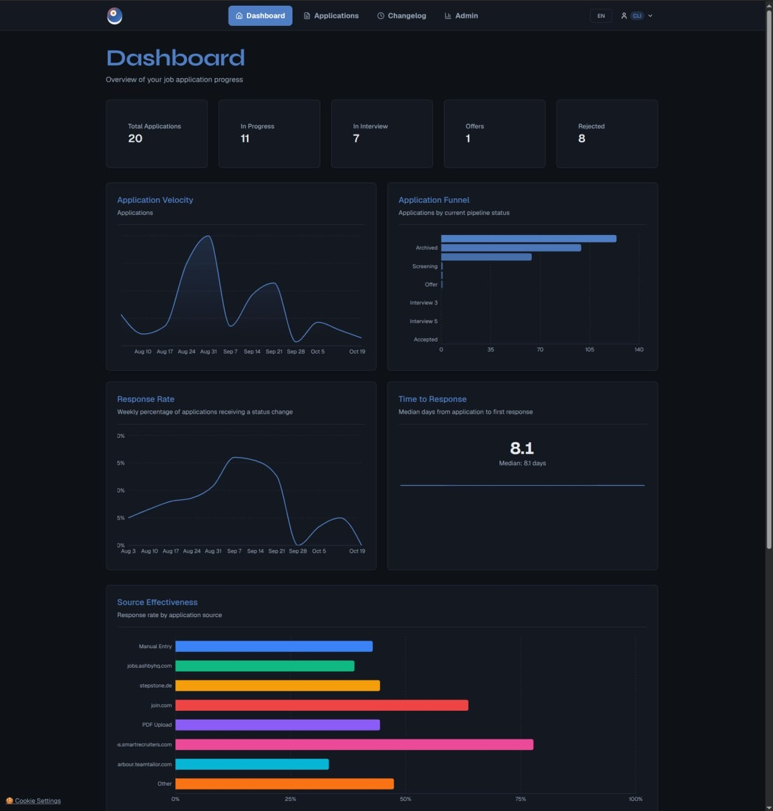

# myKaria: a production AI product built and operated by one developer

**Oluwatobi Lukan** | Hamburg, Germany | Full-stack engineer, AI application pipelines

## The short version

myKaria is a live SaaS that turns a job ad into a tailored CV and cover letter.
I designed it, built it, and run it: database, backend, frontend, AI pipeline,
billing, deployment. It is one repository, about 200 commits, 68 database
migrations and 23 document templates, running in production at
[mykaria.com](https://mykaria.com). It began as my own tool during my own job
search in Germany.

## The problem, stated precisely

Every AI CV tool optimises for interview invitations, so they exaggerate. The
candidate gets the interview and loses it, because the document claims things
they cannot defend. Recruiters now discount generated CVs by default.

Defensibility is not a writing problem, it is a ranking and policy problem:

- which of the candidate's skills match this role, and how strongly
- what proficiency level can honestly be claimed for each
- which skills to feature, mention, frame as growth, or omit
- how to address missing requirements with real adjacent experience, and never
  with invention

## Three decisions that shaped the build

**One matching call, not three.** The obvious pipeline is match, then plan, then
write. I collapsed it to a single indexed matching call whose result feeds both
documents. That removed a third of the latency and removed a class of bug where
the CV and the letter disagreed about the same skill.

**The model judges, the code enforces policy.** Anything that must hold every
time, such as a beginner skill never appearing as expert or an irrelevant skill
never reaching the prompt, is implemented in tested code rather than requested
in a prompt. Truncated model output is treated as a correctness failure, not a
quality annoyance, because an empty skill list used to let anything through.

**A modular monolith.** At one developer, splitting services would add
operational cost and buy nothing. The useful boundaries are module boundaries,
backed by 33 route modules and domain services with their own tests.

## Evidence

- 148 unit tests in the public slice, covering prompt assembly and the matching
  pipeline end to end, including the failure paths
- 274 test and spec files across the full repository
- Provider-agnostic LLM layer: OpenAI, Anthropic, Ollama, OpenRouter and any
  OpenAI-compatible endpoint, with retry, fallback and per-call cost resolution
- Multi-tenant SaaS mechanics: JWT auth with email verification, tier
  entitlements, Stripe billing, data isolation, GDPR retention and deletion jobs
- Docker Compose environments, Jenkins pipeline, Nginx-backed deployment

## Where it came from

myKaria started as my own tool. I was applying for job after job in Germany and
tailoring every CV and cover letter by hand: reading the company, working out
which of my skills genuinely mattered for that role, rewriting the same history
twenty times. So I built the pipeline to do it for me.

Then I used it on my own applications. Company research, honest skill matching,
generated documents, section by section edits before sending. What survived that
use is what shipped: anything that did not get me a better application out the
door did not make it into the product. Once it was working reliably in my own
workflow, making it available to other people was the obvious next step.

That origin still explains the codebase. The honest skill tiers exist because I
would not walk into an interview unable to defend a line on my own CV. The
section editing exists because a generated document always needs one more pass.
The gap framing exists because a missing requirement is a conversation I had to
be ready for, not a word I could invent.

## What this says about me as an engineer

I can take an ambiguous product idea to a running system: schema design,
provider abstraction, prompt engineering with guardrails, billing, deployment,
and the unglamorous parts such as retention jobs and idempotency. I know where
AI belongs in a system and, more usefully, where it does not.

## Links

- Product: https://mykaria.com
- Code excerpts: https://github.com/ztobs/mykaria-showcase
- Architecture notes: `docs/architecture.md` in that repository

Contact: tobilukan@gmail.com
